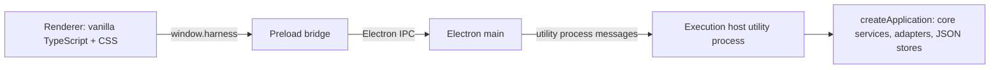

# Desktop application

Status: first desktop UI implemented, updated 2026-10-14. It presents the headless MVP described in [MVP implementation](mvp.md) according to the [UI specification](ui-spec.md). Background mode, distribution packaging, and automatic host recovery are not implemented.

## Process layout



| Process | Source | Owns |
| --- | --- | --- |
| Execution host | `src/desktop/host/` | The composed application, every in-flight `ExecutionHandle`, pending approvals, and the command dispatcher. Started with `utilityProcess.fork`. |
| Electron main | `src/desktop/main/` | App lifecycle, the window, request validation at the privileged boundary, relaying commands to the host, broadcasting host events, native dialogs (the folder picker), and stop-on-exit. Holds no application state. |
| Preload | `src/desktop/preload/` | Exposes `window.harness` with `invoke`, `onEvent`, `selectDirectory`, and `openPath` only. Raw `ipcRenderer` is never exposed. |
| Renderer | `src/desktop/renderer/` | Presentation. A view cache of host data that can be rebuilt from host queries at any time. |

The host runs outside main so provider processes and JSON persistence never block the window event loop, and so the future background mode can decouple the host's lifetime from windows without moving application code. This follows the architecture's recommendation of an execution host independent of renderer windows. The host is not yet supervised: if it exits, main reports `host.status: exited`, pending requests fail with `host_unavailable`, and the renderer shows a banner. Restarting a crashed host and recovering runs it left in `running` need a recovery policy first.

## Contracts

`src/contracts/desktop/` holds the serializable transport schemas shared by all four processes:

- `commands.ts`: `HostCommandMap` (command name to params and result) plus a runtime validator per command. Main validates every renderer request and the host validates again. Unknown keys are rejected.
- `events.ts`: `HostEvent`, facts the host broadcasts (`run.started`, `run.updated`, indexed `run.event`, `run.approval_resolved`, `run.cancel_requested`, `run.finished`, and `*.changed` refresh signals). Main adds `host.status`.
- `views.ts`: read models. They reuse core types through type-only imports, except `AccountView`, which omits the credential reference and runtime-context ID.
- `errors.ts`: stable `HostErrorCode`s with structured `details` (for example, the owning attempt for `project_busy`). Clients branch on codes and never parse messages.

To add a command, add an entry to `HostCommandMap` and `COMMAND_VALIDATORS`, then add a handler in `HostApi`. The handler table is typed against the map, so a missing handler is a compile error.

The folder commands are `projects.list` and `projects.create`. Sessions, runs, and model discovery use `projectId`; refresh notifications use `projects.changed`. Old `workspaces.*` commands are no longer accepted. Legacy saved data migrates automatically as described in [MVP implementation](mvp.md).

## Host behavior

`HostApi` (`host-api.ts`) has no Electron dependency and is covered by headless tests. `ActiveRuns` (`active-runs.ts`) is the only consumer of each handle's `events`:

- Each event is broadcast with its index within the run, and the host keeps a copy of every event for active runs. `runs.active` returns those snapshots with pending approvals. A client that reconnects subscribes first, renders the snapshot, and then applies only live events whose index is not yet in it. Reloading the renderer never restarts or duplicates a run.
- Approvals stay pending in the host until any client answers them. A renderer disconnect is not a cancellation.
- `runs.cancel` is idempotent. The run stays active until the runtime reports a terminal state.
- Before starting, `runs.start` refuses a project that already has a writer and returns `project_busy` with the owning attempt. The core lock remains the authoritative guard. When no account is named and the provider's selected account was not used, the result reports `fallbackFromAccountId`.

## Exit behavior

This implements the default stop-on-exit policy from the architecture. Closing the last window quits the app on every platform. If runs are active, main asks for confirmation, sends the host a `shutdown` message that cancels every run and waits up to 10 seconds for terminal states to be persisted, and then terminates the host. If the user chooses to keep working, the window reopens. The confirmation wording is provisional.

## Renderer

The composer has a clipboard button with an upward-opening attachment menu:
Images, Documents, Code and text, or Any file. Multi-file selections appear as
removable filename/size chips and can be sent with or without prompt text.
Sent attachments remain visible on their turn after reload. Copies live in
session-owned storage outside the project, with limits of 20 files per message
and 50 MB per file. See [session file attachments](attachments.md) for runtime
reading, per-session drafts, process boundaries, and retention.

The renderer is framework-free TypeScript with plain CSS. `store.ts` holds one immutable state object. Panels subscribe through selectors and re-render only the slice they watch, with updates batched to animation frames. Forms live in static DOM so typing is never interrupted. `controller.ts` is the only module that calls the host and maps error codes to messages. `transcript.ts` is a pure function that folds runtime events into display items for both live runs and reconnect snapshots. Features under `features/` are mounted explicitly from `app.ts`.

Layout:

- **Toolbar.** A slim bar above the session holds the left and right sidebar toggles and the session title with its project path. On macOS it is also the window drag region and leaves room for the window controls.
- **Accounts (Settings).** "Connect Codex account" and "Connect Claude account" buttons come from `auth.providers`. A sign-in shows a progress card: the browser step (with "Open sign-in page"), a device code, or a code field when the provider asks for a pasted code, plus Cancel. Saved accounts have Select and Reconnect. When no account exists, the composer shows a "Connect an account" pill. The renderer opens the sign-in page itself only when the provider did not (`urlOpenedByProvider`), and only for sign-ins started in that window. Main opens https links in the default browser.
- **Project creation.** The folder-plus button opens the native folder picker. Choosing a folder creates one project through `projects.create`, or reuses it when that folder was already added; its folder name is the display label. Duplicate saved paths consolidate during startup, bringing both sets of sessions under one row. There is no separate workspace record, setup form, or typed path field. The folder picker is a desktop-shell operation: main shows it through `selectDirectory` and returns only the chosen path.
- **Left sidebar.** It is retractable and resizable: drag its right edge (200-480 px), or focus the edge and use the arrow keys; double-click resets to 256 px. One unified project tree lists every project folder, with its sessions nested beneath it on padded rows along a guide line. A project's database button opens local Codex/Claude session discovery, preview, and import (see [local session import](session-import.md)). Its plus button immediately creates a session with a generated title; there is no session title or project picker form. A session with an active run shows a spinning icon, and a collapsed project shows the spinner in place of its session count. A session whose run is waiting for an approval shows a pulsing hand icon and "Needs approval" in place of its age, whether or not it is the open session; a collapsed project shows the hand instead of its count. Waiting outranks running, and the state comes from the host's pending approvals, so it survives renderer reloads. The folder name and optional starting revision are shown; shared/isolated folder kinds are no longer part of the project model. Settings is at the bottom. When the sidebar is collapsed, moving the pointer to the window's left edge slides it in over the content. It hides again when the pointer leaves, unless focus or one of its menus is still inside.
- **Main column (chat).** Each run is one turn. The prompt is a right-aligned bubble with no expandable `userMessage` metadata, and long prompts are clipped behind "Show full message". The reply is plain page text rendered from a small, safe Markdown subset (`markdown.ts`: paragraphs, headings, lists, quotes, fenced code, GitHub-style pipe tables with column alignment, inline code, bold, italic, and http(s) links that open in the default browser; DOM is built from text nodes only). Tables scroll horizontally inside their own frame when wider than the column, and a table that is still streaming renders as text until its delimiter row is complete. Active runs stream text and show tool activity cards with readable command/file targets, outcomes, durations, output, and styled diffs. Provider-exposed thinking text is shown directly as prose beside a lightbulb, with no text label; the lightbulb collapses it to a one-line preview. Summaries and traces remain distinguishable through the lightbulb's accessible name and tooltip. Pending approvals are not transcript items; they appear in the composer overlay. While a run is queued/running, its reply ends with an animated three-dot progress indicator. The date/time footer appears only after it ends. Stop remains in the composer; diagnostic information is available in the right panel’s Run details surface. A left-edge navigator shows one tick per turn and highlights those in view, and a "Scroll to end" pill appears away from the bottom.
- **Composer.** One card holds an auto-growing prompt, clipboard attachment action, permission/account pill menus, one model-settings pill, and a round send button. The model pill opens a compact dropdown above the composer with model names grouped by provider. There is no search field, heading or backdrop; descriptions are available in tooltips. Choosing a model replaces the list with its reasoning slider and a small Fast on/off tag. The back arrow returns to the list; the checkmark closes the dropdown. Clicking outside or Escape also dismisses it, and both stages stay anchored to the picker. Reasoning stops follow the reported levels in order, using the last supported choice, the reported default, or a synthetic Default stop when none is reported. Models without reasoning controls show automatic reasoning. Fast is enabled only for models whose adapters report both standard and fast options; its boolean preference carries across supported models. Provider/runtime routing stays hidden in the selected model. Discovery refreshes after account/project changes and reports partial failures while retaining successfully discovered models. The send button becomes Stop while the session has an active run. Enter sends, Shift+Enter inserts a newline, and Escape stops the current session's run without clearing the draft. Open menus, modals and Settings consume Escape first. Pending permission requests float above the composer and show only the proposed action/target, diff or arguments, and provider reason. Allow/Deny answer that request without submitting or cancelling the turn. The permission menu contains Ask me, Approve for me, Full access, and Read only; unsupported modes stay disabled and native mappings remain in Run details. The account menu is filtered to the selected model's provider and includes Auto.
- **Right sidebar.** Retractable via its toolbar toggle, and resizable by dragging its left edge (260-760 px, default 320 px). Changes opens by default with compact Staged Changes, Changes and Merge Changes file lists, counts, colored status letters, and repository/branch headers. Selecting a file opens its numbered inline or split diff; partially staged files have separate staged and working-tree comparisons. Repository discovery actions live in an options menu. See [Changes panel](changes-view.md) for behavior and limits. Reads refresh every two seconds while visible, on project/run transitions, and on Refresh. This includes pre-existing edits; it is not a per-run attribution. All surfaces opens the launcher with Changes, Run details, and enabled plugin previews. Run details includes a run picker, usage, account/model/permission mapping, recovery and journal. The launcher shortcuts open surfaces when focus is outside a text field.
- **Settings overlay.** General (appearance), Accounts (registration, selection, re-authentication), and Plugins (preview toggles stored per device) work. Permissions, Shortcuts, Notifications, About, Startup, and Exit behavior are labelled placeholders. When plugins gain host-side behavior, their toggles must move to the host so composition can validate dependencies.

Local session import supports per-row checkboxes, Select all for not-yet-imported sessions, a selected count, and partial-failure retries. Successful imports remain saved if another source fails.

Thinking and tool activity remain visible after a run finishes. The current-session renderer cache retains live events at completion and rebuilds saved activity from the execution journal after reload. Tool IDs correlate parallel calls; output deltas do not mark a tool complete.

Links and paths are clickable. Bare http(s) URLs in replies are linked (both schemes open in the default browser; other schemes are refused). File paths in replies, inline code, file activity targets, approval targets, and the Changes file list call `openPath`; relative paths resolve against the session's project (or the repository folder in Changes), and a `:line[:col]` suffix is ignored when opening. Electron main (`main/open-path.ts`) opens documents and folders with their default application but only reveals in Finder anything whose default open could execute code (execute bit, scripts, `.app` and other bundles, installers, `.py`). A missing path shows a notice.

Scrollbars are minimal: 4 px rounded thumbs with no track, shown only while the pointer is over the scrolling region.

Sidebar collapse state, panel widths, expanded folders, enabled plugins, and appearance are per-device renderer preferences stored in `localStorage`.

The renderer uses no platform-default choice controls: custom dropdowns (`components/dropdown.ts`) replace every native `<select>` (including the Changes repository and Run details pickers, which are created once and re-attached so re-renders do not close an open menu), and `components/checkbox.ts` replaces native checkboxes (ARIA checkbox with checked, mixed, and disabled states). They render in a popover attached to `<body>` (`components/popover.ts`) that opens upward when there is no room below. Popovers are capped at 320 px (configurable per popover) and scroll beyond that, with provider group headings pinned while scrolling, so long catalogs stay in a short box. They follow the listbox keyboard pattern (arrows, Home/End, type-ahead, Enter, and Escape) and support option icons, descriptions, groups, and disabled options.

Visual language: neutral charcoal or off-white surfaces, rounded cards, an inverted primary button, Inter for prose, and IBM Plex Mono for labels and values. There are no status dots. Status is always an icon plus a word. Icons are Phosphor (`@phosphor-icons/core`, regular weight), imported individually in `icons.ts` and inlined by esbuild. Fonts are bundled from `@fontsource`, so the strict Content-Security-Policy never allows a remote host.

Appearance is Light, Dark, or System, chosen in Settings, General. The choice is a per-device preference stored in `localStorage`. System follows `prefers-color-scheme`. All colors are CSS variables on `:root`.

## Build and run

```bash
npm run start          # bundle to dist-desktop/ and launch Electron
npm run build:desktop  # bundle only (scripts/build-desktop.ts, esbuild)
npm run typecheck      # Node and renderer tsconfig projects
npm run check          # typecheck, headless build, tests, desktop bundle
```

`THINKING_AND_CODE_DATA_DIR=/path` makes the host use a separate data directory instead of `~/.thinking-and-code`. The Electron binary is downloaded by its package install script. If npm's install-script policy skipped it, run `node node_modules/electron/install.js`.

## Known gaps

- The Claude sign-in drives the interactive `claude auth login --claudeai` command. Its output is not a stable protocol, so URL and code-prompt detection is best-effort. It has not been exercised end to end from the app.
- A reconnect leaves the account's previous runtime-context directory, and the login inside it, on disk, because an active run may still use it. Cleaning up superseded contexts needs a policy.
- Accounts registered by reference (headless `accounts.register`) are `unknown` until an adapter reports availability. Connected accounts are marked `available` on a successful sign-in.
- Tool results carry no call ID, so the transcript pairs each result with the most recent unanswered tool request.
- There is no packaging or code signing. Node packages stay external to the main and host bundles.

### Collapsed tool activity

Consecutive calls now share a borderless collapsed row showing the call count and
aggregate activity/failure status. Expanding it reveals the individual calls,
each with its existing argument/output disclosure. Text, thinking, and status
messages break groups. Group and call expansion choices survive streaming
redraws while the session view remains mounted; completed and imported history
use the same presentation. Single calls keep their individual disclosure.

Command and other tool activity starts collapsed as a compact dropdown row. The row shows the current status and command or target (for example, “Running command — npm test”), then updates when the action completes, fails, or stops. Click or keyboard-activate the row to reveal arguments, output, errors, and diffs. Expansion choices persist through streaming updates within the current view; long commands are shortened in the row and remain available in full inside the dropdown.

### Sidebar ordering

Drag a project folder above or below another folder to reorder projects. Drag a session above or below a sibling to reorder sessions within that project. A drop line previews placement. With a row focused, Alt+Up/Down moves it one position. Order is saved locally in desktop preferences and survives reloads; new rows append after saved rows. Sessions retain their project association. Folder rows and tool dropdown summaries use tighter vertical padding.

### Streaming and diff limits

Thinking and response chunks update the transcript as normalized provider events arrive, with UI redraws batched to the next animation frame. Claude requests partial SDK messages and preserves readable initial block content; final messages do not repeat streamed text. Only provider-exposed readable thinking can appear.

Git status/diff reads are read-only and scoped to the saved project folder. Status rows are limited to 500 per repository. New-file previews are limited to 50 files and 128 KB per file; binary/special files remain in the list with preview notices. Per-file previews share a 1-million-character budget; the legacy combined patch has a separate 1-million-character cap. Git commands have a five-second timeout and a 2 MB output ceiling; failures show an error rather than an empty/clean result. No filesystem watcher or per-run baseline is created.

### Native permission choices

Approve for me uses the provider’s own automatic reviewer: Codex `auto_review` with the workspace-write sandbox, and Claude SDK `auto`. The provider can approve or deny an action; Rack does not open its manual tool-approval dialog for this mode. Ask me forwards native permission requests to Allow/Deny. Full access uses native bypass controls. Read only uses the native read-only sandbox/planning mode and denies requested mutations. The permission picker shows the active run’s selected mode and stays disabled until it ends, so it cannot imply that a setting changed mid-run.
